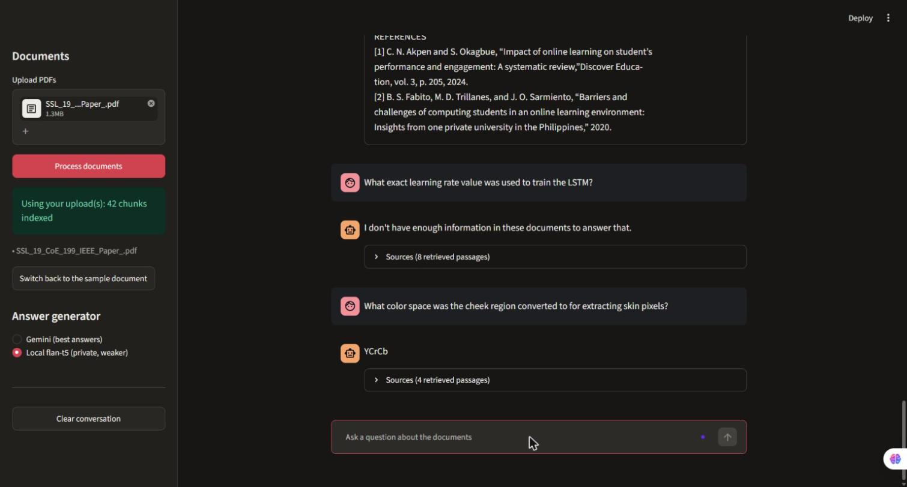
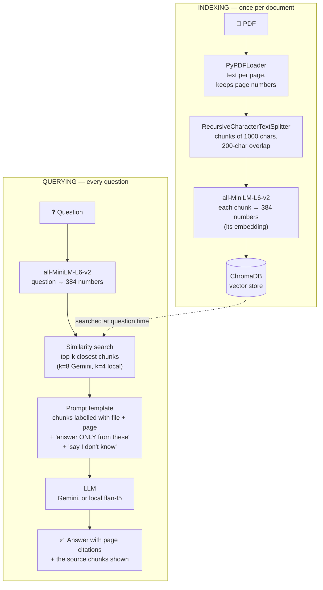

# 📚 RAG Document Q&A

Ask questions about your PDFs and get answers that cite the page they came from — and that say "I don't know" when the documents don't cover it.

**Live demo:** https://huggingface.co/spaces/YOUR-HF-USERNAME/rag-document-qa  <!-- replace after deploying -->



---

## How RAG works

A large language model (LLM) like Gemini or ChatGPT only knows what was in its training data. It has never seen your lecture notes, your company's policies or the paper you're writing, and its knowledge stops at a training cut-off date. Ask it about your own documents and it will either admit it doesn't know or — worse — produce a confident, plausible answer that is invented.

One fix is **fine-tuning**: training the model further on your documents. But that is expensive, needs ML expertise, and goes stale the moment a document changes — you'd have to retrain. **Retrieval-augmented generation (RAG)** sidesteps both problems by leaving the model alone. Instead, at question time, it *looks up* the passages of your documents that are relevant to the question and pastes them into the prompt. The model then answers from text it can see, like an open-book exam.

To make the look-up work, every document is first split into small passages ("chunks"), and each chunk is turned into a list of numbers (an **embedding**) that represents its meaning. Chunks about similar topics get similar numbers. When you ask a question, the question is embedded the same way, and the chunks whose numbers are closest are retrieved — this finds passages by *meaning*, not just matching words.

The final ingredient is the prompt. The model is told to answer **only** from the retrieved passages, to cite the page of each claim, and to reply "I don't have enough information in these documents to answer that" when the passages don't contain the answer. That last instruction matters most: without it, the model falls back on its general knowledge whenever retrieval fails, and you can't tell a grounded answer from an invented one. Because the app also shows the retrieved passages under every answer, you can check the answer yourself instead of trusting it.

## Architecture

RAG has two separate phases. **Indexing** happens once per document; **querying** happens for every question. Mixing them up is the most common misunderstanding of RAG.



## Tech stack — and why

| Component | Version | Why this choice |
|---|---|---|
| Python | 3.13 | Current stable release. |
| Streamlit | 1.67.0 | A chat UI in pure Python; supported directly by Hugging Face Spaces. |
| LangChain (core / community / text-splitters / huggingface / chroma) | 1.7.7 / 0.4.2 / 1.1.3 / 1.2.3 / 1.1.0 | Standard building blocks for loading, splitting and storing. Pinned exactly: 1.x moved imports compared with 0.x, so most online tutorials' imports no longer work. |
| PDF parsing: `pypdf` via PyPDFLoader | 7.0.0 | Pure Python, no system dependencies, keeps page numbers for citations. |
| Chunking | 1000 chars, 200 overlap | ~150–250 words: enough for a complete thought, small enough that each chunk is about one topic, so its embedding is sharp rather than an average of many topics. The overlap means a sentence on a chunk boundary still appears whole in one chunk. 20% overlap is a common starting point, not a law — it hasn't been tuned yet. |
| Embeddings: `sentence-transformers/all-MiniLM-L6-v2` | sentence-transformers 6.2.0 | 384 dimensions, ~90 MB, fast on CPU. Larger embedding models retrieve somewhat better but are much slower per query on a free CPU-only Space. |
| Vector store: ChromaDB | 1.5.9 | Zero setup: runs inside the Python process, no server or account. Configured for cosine similarity so scores are easy to read. |
| Hosted LLM: Gemini `gemini-3.5-flash-lite` via `google-genai` | google-genai 3.0.0 | Good answers on a free tier. Flash-lite rather than flash because flash's free tier allowed only 20 requests/day in testing. `google-genai` replaces the older `google-generativeai` SDK, which Google no longer supports. |
| Local LLM: `google/flan-t5-base` | transformers 5.22.2, torch 2.15.0 (CPU) | Runs with no API key and keeps all data on the server. Much weaker answers — see Limitations. |

## What it costs

Precisely, rather than "completely free":

- **Retrieval — free and local.** PDF parsing, chunking, embedding and vector search all run on the server's CPU. No API, no account, no per-query cost.
- **Generation with Gemini — free tier, with limits.** The free tier has a daily request cap per model, **shared by every visitor to the public demo**. (gemini-3.5-flash allowed 20/day in testing; flash-lite has its own, separate quota — see your limits at https://aistudio.google.com/rate-limit.) With Gemini selected, your question and the retrieved passages are **sent to Google**.
- **Generation with the local model — free, private, weaker.** flan-t5-base runs on the CPU. Nothing leaves the server. If no Gemini key is configured, or the daily limit is used up, the app switches to it automatically and says so.
- **Hosting — free.** A free Hugging Face CPU Space. It sleeps when idle, so the first visitor after a quiet period waits for a cold start (~20 s measured locally with the models already downloaded; longer on a freshly restarted Space, which must download them again).

## Run it locally (Windows CMD)

```bat
git clone https://github.com/YOUR-GITHUB-USERNAME/rag-document-qa.git
cd rag-document-qa
py -3.13 -m venv .venv
.venv\Scripts\activate
pip install -r requirements.txt

:: Optional - without a key the app uses the local model.
:: Get a free key at https://aistudio.google.com/apikey
echo GEMINI_API_KEY=paste-your-key-here> .env

streamlit run app.py
```

Then open http://localhost:8501. To test the pipeline from the command line with your own PDFs, put them in `data\` and run:

```bat
python src\ingest.py
python test_retrieval.py
python test_rag.py
python test_rag.py compare
```

## Project structure

```
app.py                 Streamlit UI (caching, session state, uploads) - no RAG logic
src/config.py          chunk size, model names, k, paths, seed
src/ingest.py          PDF -> chunks -> embeddings -> Chroma
src/retrieve.py        question -> top-k chunks with similarity scores
src/generate.py        prompt template + Gemini / local generators
src/rag.py             retrieve -> prompt -> generate -> answer + sources
sample_docs/           the small demo PDF bundled with the app
scripts/               generator for the sample PDF
test_retrieval.py      retrieval-only checks (scores, ranks)
test_rag.py            end-to-end checks, Gemini vs local comparison
```

## Limitations

These come from a 10-question test run of the app (5 questions on the bundled guide, 5 on an uploaded 11-page research paper on webcam heart-rate measurement), plus the earlier development tests.

**It refused the unanswerable questions correctly.** Asked *"How much does it cost per month to host this app on Hugging Face?"* and *"Was the rPPG algorithm tested on infants or newborns?"*, it replied with exactly: *"I don't have enough information in these documents to answer that."* In development it also refused a deliberately tricky question — *"What exact learning rate value was used to train the LSTM?"* — about a paper that says the learning rate was *tuned* but never gives the value.

**But it also refused two questions that the paper does answer** — and that is the main weakness:

- **Retrieval quality caps answer quality.** The LLM cannot use a passage that was never retrieved. *"What range of heart rates was treated as valid?"* was refused because the paper phrases the same fact as an exclusion rule ("we removed all videos … lower than 50 or higher than 120 beats per minute"). Embedding search ranked those chunks 43rd–49th out of 60. *"What minimum frame rate did videos need in the online study?"* was refused because the right chunk ranked 11th, just outside the top 8.
- **Similarity scores can't detect "not in the documents".** In development, an unanswerable question (*"How accurately can rPPG measure blood pressure?"*) scored 0.571, higher than four of six answerable questions. So there's no score threshold for "I don't know"; that job falls to the prompt.
- **Chunk boundaries.** A fact split across two chunks may be retrievable from neither. The 200-character overlap reduces this but doesn't eliminate it. Relatedly, a chunk that starts with an unrelated paragraph gets a "diluted" embedding: in development, the passage naming a model's training dataset ranked 12th for the question *"What dataset was used to train it?"*
- **It faithfully repeats the source — including the source's errors.** One test paper says "231 online video recordings" on page 1 and "213" on page 4. Asked for the number, the app answered 213 and cited page 4 — correctly grounded, but a reader should check both.
- **No persistence on Spaces.** Hugging Face Spaces have an ephemeral filesystem. Uploaded documents live in memory for your session only and vanish when you close the tab or the Space restarts. That's also a privacy feature: nothing you upload is stored.
- **English-focused embeddings.** all-MiniLM-L6-v2 was trained mainly on English; retrieval in other languages is poor.
- **Scanned PDFs don't work.** If a PDF contains images of text rather than real text, there's nothing to extract without OCR. The app detects this and says so.
- **The local model is much weaker.** flan-t5-base gives one-phrase answers, doesn't cite pages, and gets more wrong — in testing it answered "Gorilla" (the recording platform) when asked which software converted the videos (HandBrake). Its first prompt hallucinated on both unanswerable questions; asking for the word "unanswerable", the refusal format it was trained on, fixed that.
- **Shared free-tier quota.** Every visitor to the public demo draws from the same daily Gemini limit; after that, answers come from the local model.

## What I learned

- **Test retrieval before generation.** The best LLM can't fix a chunk that was never retrieved. Checking *where* the answer chunk ranked (not just the scores) found the real failures.
- **The "say I don't know" instruction works — with a capable model.** Gemini refused every unanswerable question. The small local model ignored a long instruction until the prompt used the exact phrasing it was trained on.
- **Model limits are part of the design.** Gemini's thinking tokens silently truncated answers until the output limit was raised; a 512-token input limit means flan-t5 needs the question *before* the context, or truncation cuts the question off.
- **Shared caches leak.** In Streamlit, `st.cache_resource` is shared by all visitors, and in-memory Chroma stores in one process share a backend. Uploaded documents therefore live in per-session state with a unique collection name.

## What I'd do next

1. **Hybrid search (BM25 keyword + vector).** This is the standard fix for the failures above. The "frame rate" and "heart rate range" questions contain exact terms ("frame rate", "beats per minute") that a keyword index ranks highly even when the embedding doesn't. Retrieve with both, then merge the rankings (e.g. reciprocal rank fusion).
2. **A re-ranker.** Retrieve ~20 chunks cheaply, then score each against the question with a small cross-encoder and keep the best 8.
3. **Tune chunking against these test questions.** The baseline (1000/200) hasn't been tuned. Now that there's a fixed question set with known answers, chunk size and k can be compared by how often the answer chunk lands in the top k.
4. **Automated evaluation.** Turn the test questions into assertions (answer contains X; cited page is Y; unanswerable → refusal) so changes can be checked in one command.

## License

MIT
